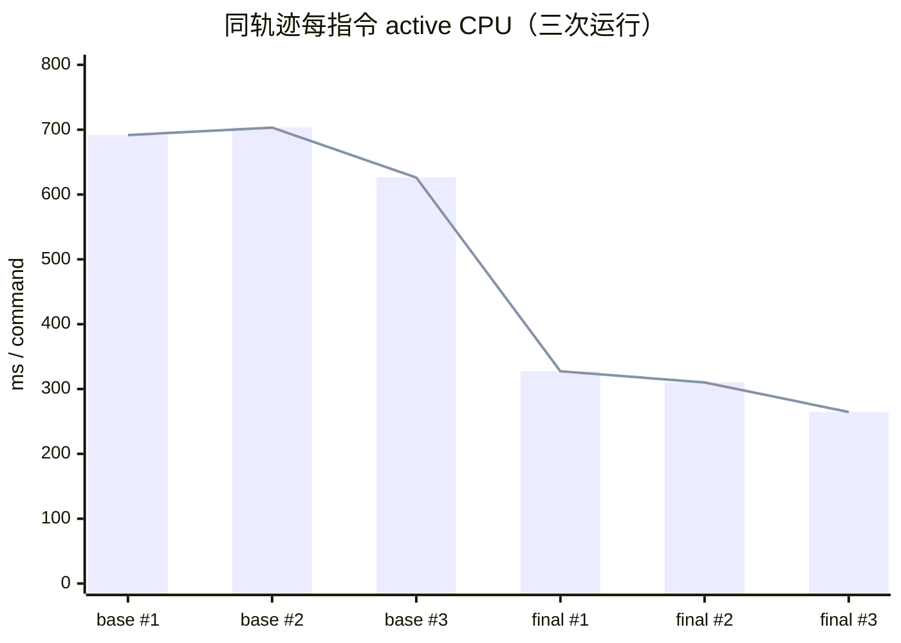
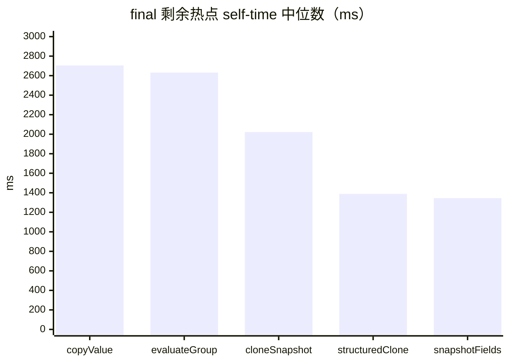

# 服务端性能优化总验收（2026-10-27）

## 结论

**未达到“单房间 p95 ≤ 300 ms”目标。** 在最终提交 `97029783` 上，同一条经过认证的真实 M1 轨迹（78 条 WebSocket 命令）三次交替采样后的回执 p95 中位数为 **1,214 ms**，p50 为 **199 ms**，p99 为 **1,965 ms**。最终版相对基线 `da4439a4 + RIFT-1090` 已把每命令 active CPU 中位数从 **691.67 ms** 降到 **310.19 ms**（下降 55.15%），把文件 archive 从 **4,907,315 B** 降到 **253,751 B**（下降 94.83%），但剩余层求值、host 复制和 journal digest 仍足以使 p95 高于目标 4.05 倍。

本次结论只适用于当前共享主机、Node 22.22.2、固定 `room 69dc614b / seed rift1091`、M1 真实生产房间和该 78 条自然命令轨迹。profile 的机器可读 compliance 记录为 `core-1.5 / protocol 2.0.0 / engine-v2`；这里核对的是性能路径没有改变这些默认边界，并按 [CR v1.5](https://cmsassets.rgpub.io/sanity/files/dsfx7636/news_live/5c7946f7c3b8c6e0faff85ab6dadc6d2e721ea94.pdf) 的 117、303、478.1–478.4 约束解读执行顺序与层求值。官方 Radiance patch notes 将 v1.5 生效日列为 **2026-10-16**：[官方公告](https://playriftbound.com/en-us/news/announcements/core-rules-radiance-patch-notes-effective-october-16-2026/)。

本次是性能验收，不是所有卡牌、所有规则路径或生产机绝对容量的证明；本次命令轨迹未出现每张卡的逐项判定证据，未知能力仍保持 `judge-required` / `blocked`，旧 profile、旧回放和 schema 均未升级。CR 117 的换牌按 turn order 执行；profile 与压测中的命令均经过权威服务端回执和两个客户端的投影收敛，不把客户端派生状态当作权威状态。CR 303.1–303.2.a 要求 game action 逐个完整执行，同时触发/效果按 turn order 排序；CR 478.1.a–478.4 要求 object dependency、循环依赖和 layer pass 在 effect-once 语义下持续重算。报告没有为所有卡牌硬编码统一 priority，也没有把 303.2.a 简化成全链统一 FIFO/LIFO。

最终压测中文件 `N=1` 完赛，p95 **1,074.03 ms**；文件 `N=5` 有 4/5 局完赛，p95 **2,313.07 ms**，一局在公开投影中找不到合法命令而报错，脚本依既有 stop rule 停止，因此 `N=10`、`N=20` 未运行。内存 `N=10` 对照为 4/10 局完赛，p95 **4,169.64 ms**，说明关闭文件存储仍不足以达到 300 ms。

```mermaid
xychart-beta
  title "同轨迹回执分位数中位数（ms）"
  x-axis ["p50", "p95", "p99"]
  y-axis "ms" 0 --> 2800
  bar [587, 1796, 2570]
  bar [199, 1214, 1965]
```





第一张折线展示六轮 run-level active CPU；第二张两组柱依次是 base 与 final 的三轮 p50/p95/p99 中位数。p95 目标线没有在 Mermaid 横轴中伪造，数值表与上方结论以 300 ms 为准。

## 基线与最终版

| 用途 | Git 提交 | 工作区 | 说明 |
|---|---|---|---|
| 优化前基线 | `8aa37ff44778c9b1bfac342f1d7510d43d838452` | `/root/swarm-rift/shared/RIFT-1091-perf-final-acceptance/base-wt` | `da4439a4` 加 cherry-pick `292b434c`；无冲突，仅加入 RIFT-1090 确定性开关和测试，无其他代码改动 |
| 最终版 | `9702978337cc0447aaca9f431e3c1287aed4c6af` | `/root/swarm-rift/shared/RIFT-1091-perf-final-acceptance/final-wt` | 用户指定的 `integration@97029783`，包含 D/A/C/E/F/B 六个性能工单 |

两个 detached worktree 均先执行 `pnpm install --frozen-lockfile --prefer-offline`，再执行：

```bash
heavy pnpm -r --filter './packages/*' --if-present run build
pnpm --filter @riftbound/game-server exec tsc -p tsconfig.json
heavy pnpm -r --filter './packages/*' --if-present run build
```

第二步是把 app 编译为 profile 脚本实际加载的 `apps/game-server/dist/server.js`；repo 约定的 packages-only build 不会生成该文件。编译后再次构建 packages，使 server 子进程从 `dist` 加载业务代码，避免 tsx loader 污染 CPU 采样。生成产物没有进入提交。

## 同轨迹认证

正式样本严格按 `base, final, base, final, base, final` 运行。每轮命令为：

```bash
SWARM_TASK=RIFT-1091-perf-final-acceptance \
SWARM_PORT_BASE=36080 SWARM_PORT_SPAN=20 \
heavy env SWARM_TASK=RIFT-1091-perf-final-acceptance \
  SWARM_PORT_BASE=36080 SWARM_PORT_SPAN=20 \
  pnpm --filter @riftbound/game-server exec tsx scripts/profile-server.ts \
  --room-id=69dc614b --deterministic-seed=rift1091 \
  --output-dir=/root/swarm-rift/shared/RIFT-1091-perf-final-acceptance/profile \
  --output-label=RIFT-1091-<base|final>-formal<1|2|3> \
  --max-commands=1000 --command-timeout-ms=120000 \
  --game-timeout-ms=900000 --startup-timeout-ms=180000
```

每一轮使用独立 storage。认证分为两层：

1. 比较全部命令的 `type / actorPlayerId / receiptStateVersion / eventSeq / accepted / duplicate / phase / turnNumber` 序列。六轮均为 78 条、同一 `player-1` winner，SHA-256 全部为 `acc46ac95a95c7e50428b29399feb51da16997c01f5eea733d646d1abadadf14`。
2. 用 final 的生产代码 `PersistentRoomArchiveStore.readArchives` 解码每个原始 log。base 的完整快照和 final 的 verified delta 均还原为 86 条逻辑 archive；剔除 `resumeToken / checksum / archive digest / wall-clock timestamp` 后逐条比较，六轮哈希全部为 `4a1d1dbdce604e1e5a4506f5d41a93bd7f5e18c0d89e37ad6cb34a5c4bd5c4c3`。

因此下文改变的是实现、采样和延迟，没有把不同轨迹当成性能提升。另有一次 base/final 预热对也通过同样认证，但不进入中位数：

| 变体 | 预热提交 | 轨迹 SHA-256 | 逻辑 archive SHA-256 |
|---|---|---|---|
| base | `8aa37ff4` | `acc46ac9…dadf14` | `4a1d1dbd…bd5c4c3` |
| final | `97029783` | `acc46ac9…dadf14` | `4a1d1dbd…bd5c4c3` |

## 正式 profile 原始样本

`active CPU` 是 1 ms CPU profile 在每条命令窗口内分到的非 idle samples，并加回 GC；`copy / layers / digest / projection / engine` 是 summary 的每命令阶段均值；GC 列为整局 GC samples 除以 78。延迟是真实 WebSocket 发送命令到收到首个 command receipt 的墙钟时间。WS 字节是该局两个客户端收到的全部 WebSocket event packet 字节，不是 projection JSON 的估算值。

| 顺序 | 变体 | 墙钟 ms | active CPU 均值 ms | active CPU 中位 ms | copy ms | layers ms | digest ms | projection ms | engine ms | GC ms/命令 | p50 ms | p95 ms | p99 ms | WS B | archive B | load 起 → 止（1m/5m/15m） |
|---:|---|---:|---:|---:|---:|---:|---:|---:|---:|---:|---:|---:|---:|---:|---:|---|
| 1 | base | 61,927.39 | 691.67 | 578.27 | 355.91 | 205.66 | 36.22 | 10.86 | 21.35 | 50.59 | 587 | 1,724 | 2,570 | 32,455,213 | 4,907,315 | `31.63/45.48/43.66 → 39.83/41.92/42.43` |
| 2 | final | 32,400.71 | 327.34 | 199.56 | 18.81 | 174.80 | 22.86 | 11.17 | 60.36 | 29.32 | 211 | 1,225 | 2,494 | 32,455,213 | 253,751 | `39.83/41.92/42.43 → 48.23/44.16/43.19` |
| 3 | base | 95,876.01 | 703.14 | 591.32 | 359.73 | 211.25 | 38.38 | 11.04 | 23.17 | 47.85 | 611 | 4,567 | 9,492 | 32,455,213 | 4,907,315 | `48.23/44.16/43.19 → 51.91/47.31/44.50` |
| 4 | final | 30,658.37 | 310.19 | 190.14 | 19.17 | 167.79 | 20.30 | 10.30 | 55.56 | 28.66 | 199 | 1,214 | 1,965 | 32,455,213 | 253,751 | `51.91/47.31/44.50 → 53.88/48.94/45.32` |
| 5 | base | 58,171.69 | 626.22 | 494.70 | 312.34 | 200.81 | 33.18 | 9.50 | 20.42 | 36.69 | 539 | 1,796 | 2,358 | 32,455,213 | 4,907,315 | `53.88/48.94/45.32 → 36.24/44.66/44.24` |
| 6 | final | 26,857.94 | 264.59 | 154.71 | 15.30 | 144.04 | 19.88 | 8.17 | 48.23 | 21.29 | 182 | 1,032 | 1,485 | 32,455,213 | 253,751 | `36.24/44.66/44.24 → 36.63/43.51/43.89` |

执行窗口内的采样 load 波动为 **31.63–53.88**；另有 occupancy 列记录 `/proc/loadavg` 的第 4 字段，但没有把其调度实体数量伪装成 CPU 核数。三轮严格交替只能降低顺序偏差，不能消除共享机排队；CPU 归因与回执墙钟因此分开呈现。

## 三轮中位数前后对比

| 指标 | 基线中位数 | 最终中位数 | 变化 | 解释 |
|---|---:|---:|---:|---|
| 每命令 active CPU | 691.67 ms | 310.19 ms | **−55.15%** | 六类有效 CPU 的主验收指标 |
| 每命令 active CPU（逐命令中位数） | 578.27 ms | 190.14 ms | **−67.12%** | 第 39 条命令的中位值，减轻少量长命令拉高均值 |
| copy 阶段 | 355.91 ms | 18.81 ms | **−94.71%** | 原先的 `structuredClone` 主路径显著下降 |
| layers 阶段 | 205.66 ms | 167.79 ms | **−18.41%** | A 工单有收益，但仍是最终首要业务阶段 |
| projection digest | 36.22 ms | 20.30 ms | **−43.95%** | C 工单的 canonical encoder/digest 收益 |
| projection 生成 | 10.86 ms | 10.30 ms | **−5.16%** | 共享中间态只改变部分开销，未改变隐藏信息分区 |
| engine（不含层） | 21.35 ms | 55.56 ms | **+160.23%** | B 的显式 host 复制被归入 engine；不能把该行单独解释为规则计算变差 |
| GC | 47.85 ms/命令 | 28.66 ms/命令 | **−40.12%** | V8 samples 随 allocations 下降 |
| 整局 effective CPU | 53,968.36 ms | 24,224.59 ms | **−55.11%** | 全部 78 条命令窗口的 CPU profile 分子 |
| 回执 p50 | 587 ms | 199 ms | **−66.10%** | WebSocket 命令 → 首个 receipt |
| 回执 p95 | 1,796 ms | 1,214 ms | **−32.41%** | 仍未达到 300 ms |
| 回执 p99 | 2,570 ms | 1,965 ms | **−23.54%** | 尾部仍明显 |
| WS 字节 | 32,455,213 B | 32,455,213 B | **0%** | 两个变体及三次运行的客户端事件字节完全相同 |
| WS 字节/命令 | 416,092.47 B | 416,092.47 B | **0%** | 投影发布形状和事件 seq 没有为提速而缩减 |
| archive 期末字节 | 4,907,315 B | 253,751 B | **−94.83%** | base 每次 full snapshot，final 使用 verified delta |
| archive 平均 record 字节 | 57,061.80 B | 2,950.59 B | **−94.83%** | 86 条记录；2,950.59 B 是 append-only 编码大小，不是逻辑 archive 大小 |

顶层 `structuredClone` self time 的每轮中位数从 **27,388.34 ms** 降至 **1,388.47 ms**；最终新增的 `copyValue` host copy 中位数为 **2,704.26 ms**。两者不能直接相消或重复相加：profile summary 的行是调用栈最内层 self samples，部分 host 复制通过普通 JS 函数而不是内置 clone 实现。

把三次 profile 的 `analysis.phaseTime`（整局 78 条命令的 CPU sample 总量）取均值后，base → final 为：copy **26,744.18 → 1,387.48 ms**、layers **16,062.55 → 12,668.04 ms**、digest **2,802.48 → 1,640.55 ms**、projection **817.49 → 772.15 ms**、engine **1,689.12 → 4,275.22 ms**、GC **3,513.51 → 2,060.93 ms**。这些是整局总量，和上面的每命令均值分别保留了原始与可读尺度；engine 的增长主要来自 B 工单把 `structuredClone` 的内部复制换成可在 JS 中采样的 host 复制，不能解释成多执行了规则。

instrumentation 调用计数在六轮严格一致，证明同一路线没有靠减少规则 pass 或跳过命令换性能：`runtimeHost.objects` **40,474 → 16,045**（wall-time 中位 2,071.89 → 1,650.51 ms），host checkpoint 均 **2,461 次**（4,481.94 → 2,555.03 ms），TurnFlow checkpoint 均 **2,478 次**（28.61 → 31.87 ms），`layer.evaluate` 均 **2,742,123 次**，`layer.evaluateAll` 均 **3,070 次**，`chain.withStableLayers` 均 **2,448 次**，journal append 均 **76 次**。最终 `withStableLayers` 的墙钟中位从 15,788.24 ms 降到 12,040.17 ms；调用次数没有下降，下降来自单次执行成本。

## 最终压测

压测使用最终版真实服务端入口、真实 WebSocket、每房间两个客户端、相同 M1 预组、`--deterministic-seed=rift1091` 和 36080–36099 端口段。参数为命令上限 500、回合上限 40、命令超时 30 秒、单局超时 780 秒、启动超时 180 秒。下表是正式文件档位与独立内存对照。

文件轨迹核验：`N=1` 为 19 turns、129 条命令、`player-1` winner；`N=5` 的五局依次为（turns / commands / 结局）：`11 / 69 / player-1`、`1 / 7 / blocked`、`12 / 87 / player-2`、`18 / 126 / player-2`、`18 / 106 / player-2`。按 mode、N、room、seed、roomId、termination、winner、turns、commands、elapsed 和 failures 生成的 file-clean 轨迹摘要为 `6473afab8ad6ad759f36fdb06276464ddef1cf439a4f65ed4da3306a72199a95`。N=1 和 N=5 是不同并发档，不能要求两档的投机执行轨迹相同；该摘要用于锁定本次证据，不用于声称跨档确定性。

| 存储 | N | 总命令 | 命令/秒 | p50 ms | p95 ms | p99 ms | max ms | 完赛 / winner | 平均每局 ms | RSS 峰值 / 平均 | 服务端 CPU 平均 / 峰值 | 新房间 archive / 每局 | 拒绝 / 错误 / 断线 / 超时 | load 起 → 止（1m/5m/15m） |
|---|---:|---:|---:|---:|---:|---:|---:|---:|---:|---:|---:|---:|---:|---|
| file | 1 | 129 | 2.85 | 173.71 | 1,074.03 | 1,958.45 | 2,307.34 | 1 / 1 | 42,770.64 | 511,553,536 / 483,401,256 B | 54.97% / 219.49% | 602,713 / 602,713 B | 0 / 0 / 0 / 0 | `74.01/53.24/47.24 → 47.55/49.98/46.62`；峰值 59.70 |
| file | 5 | 395 | 3.09 | 753.87 | 2,313.07 | 8,258.32 | 9,267.49 | 4 / 4 | 87,520.98 | 628,154,368 / 566,308,026 B | 71.90% / 340.10% | 1,483,189 / 296,638 B | 0 / 1 / 0 / 0 | `47.55/49.98/46.62 → 26.91/39.90/43.42`；峰值 37.89 |
| file | 10 | — | — | — | — | — | — | — | — | — | — | — | — | 未运行：`N=5` 的一局公开投影无合法命令，触发既有 stop rule |
| file | 20 | — | — | — | — | — | — | — | — | — | — | — | — | 未运行：`N=5` 的一局公开投影无合法命令，触发既有 stop rule |
| memory | 10 | 672 | 3.20 | 1,353.10 | 4,169.64 | 14,325.47 | 17,439.87 | 4 / 4 | 128,532.28 | 640,237,568 / 499,640,864 B | 110.63% / 280.17% | 0 / 0 B | 0 / 6 / 0 / 0 | `25.71/39.21/43.16 → 32.50/34.60/40.41`；峰值 32.50 |

文件 `N=5` 的 5 个真实房间中，4 局 winner、1 局在 `main/turn-1/state-4` 报 `no projected legal command`；没有 rejected command、断线或超时。内存 `N=10` 的 6 个 blocked 局也均为“公开投影下找不到合法命令”：三局在 turn 1 state 4 立即 blocked，另三局分别在 state 112、106、43。当前证据不能区分 bot 决策覆盖不足与产品投影/命令能力缺口，所以不能声称这 6 局是成功长局，也不能把它们归为已确认服务端崩溃；服务端进程都没有异常退出。

`N=5` 的 p95 低于脚本 3 秒阈值，但一局驱动的错误同样触发 stop rule。报告区分“p95 达标”与“该档位无错误”两件事；没有绕过 stop rule 去追加运行 10/20。内存模式不参与文件档 stop 判定，因此按任务要求单独完成 `N=10`。

### 文件和内存对比

| 对照 | p50 ms | p95 ms | p99 ms | CPU 峰值 | RSS 峰值 | 结论 |
|---|---:|---:|---:|---:|---:|---|
| file `N=5` | 753.87 | 2,313.07 | 8,258.32 | 340.10% | 628,154,368 B | 已越过 300 ms 目标；一局驱动找不到合法命令 |
| memory `N=10` | 1,353.10 | 4,169.64 | 14,325.47 | 280.17% | 640,237,568 B | 房间数更高，关闭文件存储仍远高于目标 |

这组不是同 N 的严格文件/内存 A/B：脚本把内存固定为 10，而文件在 `N=5` 触发 stop rule。它仍能证明磁盘不再是唯一主要瓶颈；规则执行、层/投影/digest、单事件循环和共享机争用继续限制并发。

### 实际 archive 体积

脚本的 `storage.growthBytes` 以整个硬编码 storage root 为初始/终止快照。正式运行开始时该目录已有历史 room，故报告中的 `storageReused=true`，`N=1 initialBytes=5,340,236`、`N=5 initialBytes=23,060,764`；growth 仍等于本档新写入的实际字节，但不能把它误写成“新房间最终 archive 总大小”。另行逐文件核对：

- 文件 `N=1` 新房间 `archive.log` 为 **602,713 B / 136 records**。
- 文件 `N=5` 五局 archive 分别为 347,141、597,021、225,752、28,142、285,133 B，合计 **1,483,189 B**，平均 **296,638 B/局**；与脚本 growth 一致。
- 对比 profile 轨迹的 base 4,907,315 B、final 253,751 B。压测房间路径不同，因此以每局约 0.30–0.60 MB 的 129–395 条命令样本做容量估算，不能把 6 位 room ID 的 profile 轨迹大小直接外推给所有房间。

## 剩余热点与下一步

final 的 Top 5 以三次正式样本 self-time 中位数排序。百分比只覆盖该轮 active CPU 分子，不把 idle 算成热点。

| 排名 | 热点 | 中位 self time | 三轮范围 | 说明与下一步 |
|---:|---|---:|---:|---|
| 1 | `copyValue`，`apps/game-server/dist/engine-runtime/host.js` | 2,704.26 ms | 2,392.63–3,049.18 ms | B 的普通 JS 深复制；检查 checkpoint/restore/object view 的重复生命周期复制与可证明不可变的共享边界，保持 rollback 和 LKO/LKI 历史 |
| 2 | `evaluateGroup`，`engine-core/layers/engine.ts` | 2,631.33 ms | 2,226.38–2,820.84 ms | 仍是首要规则阶段；按 478.1–478.4 的真实 dependency/cycle/layer pass 计数继续剖析，不能简单 memo 整轮 |
| 3 | `cloneSnapshot`，`engine-core/layers/engine.ts` | 2,022.05 ms | 1,835.85–2,075.83 ms | A 已降低一部分 predicate 成本，但 per-object snapshot 仍大；需与 `snapshotFields` 一起设计结构共享 |
| 4 | `structuredClone`，Node internal | 1,388.47 ms | 1,149.32–1,415.28 ms | 相比基线已降约 94.9%；先定位剩余调用者，再逐项消除，避免把内置 copy 全归给一个 owner |
| 5 | `snapshotFields`，`engine-core/layers/engine.ts` | 1,345.14 ms | 1,246.91–1,369.99 ms | 与 `cloneSnapshot` 合并审查 frozen fields/array 拷贝，并保持 attachment signature 与 effect-once 失效语义 |

紧随其后的成本包括 `keyword-grants.alias` 993.89 ms、`writeCanonical` 925.23 ms、`evaluateDependency` 494.96 ms、`attachmentSignature` 489.26 ms 和 `canonicalJsonInto` 421.65 ms。下一步优先级建议：



1. 为热点 1–3、5 建立生产装配的 `createProgramBinding + ChainEngine/TurnFlow + attachLifecycle` 基准，先消除可证明重复的 object/checkpoint copy，再测同一轨迹；不得用 fixture 跳步或修改 authoritative state。该基准还应覆盖 choice/fee 选择与支付、replacement/prevention、simultaneous trigger 的控制者/玩家选序、Pending/Finalize/Resolve 与 LKI，但这些语义需要各自卡文与官方裁定；缺失证据时保持 `judge-required`，本轮没有新增具体卡牌规则执行。
2. 对层求值增加按真实 dependency/cycle/effect-once 语义细分的计数器，定位 `evaluateAll → evaluateGroup → cloneSnapshot/snapshotFields` 中剩余重复；保持 CR v1.5 478.1.a–478.4 与 CR v1.5 303.2.a 的 turn-order sequencing。
3. 继续 C 的 canonical digest 调用树优化，覆盖 `writeCanonical / canonicalJsonInto`，同时锁定 legacy profile 1–9 与旧回放的 digest/schema。
4. 修复 load bot 的 `no projected legal command` 覆盖后再合法跑文件 10/20；不能把 turn-1 state-4 的 blocked 样本当作完整负载。
5. 在干净专用机复跑同样六轮和压测，补采磁盘 fsync/IOPS、CPU core profile 和 GC pause；共享机 load 31.63–59.70 使绝对延迟不是生产 SLA。

## 推荐云资源配置

本轮的 SLO 未通过，因此下表是**当前可证明的保守部署配置**，不是达到 300 ms 的推荐容量。按一个 Node 进程承载同时进行的真实对局数，并给每个进程独立的 CPU/RSS 配额。

| 部署档 | CPU | 内存 | 磁盘 | 每进程同时对局 | 网络 | 依据与限制 |
|---|---:|---:|---|---:|---|---|
| 当前验收下限 | 4 vCPU | 4 GiB | 50 GB NVMe / 低延迟 SSD | **1 房间（2 客户端）** | 至少 10 Mbps 持续、100 Mbps 突发；每活动连接按约 0.6 MB/s 投影输出预留 | p95 1,214 ms（<3 秒但 >300 ms）；RSS 峰值约 0.64 GiB，CPU 峰值约 2.2–3.4 核；只为可用性留余量，不代表 SLO 达标 |
| 候选、未达 SLO | 8 vCPU | 8 GiB | 100 GB+ NVMe | 最多 5 房间，仅限 beta 且需错误门 | ≥50 Mbps 持续、200 Mbps 突发 | `N=5` 完赛 4/5、p95 2.313 s、CPU 峰值 340.10%；一局 blocked，未通过最终产品门 |

Bandwidth 以主要场景的 WS 字节为依据：profile 每命令中位 416,092.47 B，命令速率约 2.85 条/秒，单房加两个客户端约 **1.2 MB/s** 的代理/应用出口压力；云带宽还应覆盖代理、压缩前的 burst、reconnect/backfill 和日志上传余量。磁盘以干净文件局的 0.23–0.60 MB archive/局为下界，并按保留期、历史 checkpoint、审计副本和并发放大预留；50 GB / 100 GB 是短期容量，不是无限 retention。

若要满足 300 ms，不应通过增加 vCPU 宣称“完整多线程规则引擎”。Node 主线程的规则/投影执行仍是串行；横向扩容的最小单位是每进程 1 个已验收房间，且必须先在干净机上达到 SLO，再提升每进程房间数。除非完成热点工单并复测，否则不推荐把 `N=5` 作为生产容量或把两档写进 SLA。

## 方法和局限

- profile 服务端子进程显式启用 `--cpu-prof --cpu-prof-interval=1000`，从构建后的 `dist` 加载；父进程用真实 WebSocket 驱动两个 M1 客户端，执行命令后才进入下一步。
- 三轮每变体的中位数由相同 78 条命令、同一固定 room/seed 的样本计算。运行顺序严格交替；预热对不计中位数。
- 原始 archive 在 base 是完整 snapshot，在 final 是 `room-archive-delta`。不能直接比较逐行 checksum；本报告用 final 的生产读取器把它们归一成逻辑 archive，且命令/投影轨迹先通过哈希认证。`resumeToken` 和 `checksum` 等存储身份字段只用于剔除后的轨迹比较，没有被改写为 game state。
- latency 是父进程墙钟的回执延迟；CPU 分位数只来自 profile samples，墙钟尾部会受共享机排队、WS I/O 和进程调度影响。
- 压测不是同 N 文件/内存矩阵，因为脚本固定内存 N=10；文件 N=10/20 按既有 stop rule 未运行，不能标为通过。
- 压测 storage root 在脚本内硬编码，正式记录显示 preexisting storage 和 `storageReused=true`；报告用新增 room 的逐文件大小校正，不用累计目录大小假装新对局 archive。
- 没有修改产品代码、测试、契约、lockfile、card-data、旧 profile 或旧回放。没有做 PostgreSQL、生产数据库、部署、push 或其他共享测试库操作。
- 当前结论只证明固定的 M1 自然轨迹和调度。没有证明所有官方卡牌/效果的性能，也没有把 `judge-required` / `blocked` 能力改成可执行。默认房间仍为内存，文件存储的 durability 仍需要单独 restart/recovery 验收。

## 验收状态

| 验收项 | 状态 | 证据 |
|---|---|---|
| 基线可复现 | 完成 | `da4439a4 + 292b434c` detached worktree，无 cherry-pick 冲突 |
| 同轨迹前后对比 | 完成 | 六轮正式样本、命令/投影哈希和逻辑 archive 哈希全部一致 |
| 中位数表 | 完成 | active CPU、copy/layers/digest/projection/engine、GC、回执分位、WS、archive 均已列出 |
| 最终文件压测 N=1/5/10/20 | 部分完成 | N=1、5 已跑；N=10/20 按授权 stop rule 未跑 |
| 最终内存 N=10 | 完成 | 4/10 winner，p95 4,169.64 ms |
| 单房间 p95 ≤ 300 ms | 未达成 | final 同轨迹 p95 中位 1,214 ms；压测 N=1 p95 1,074.03 ms |
| 热点 Top 5 与建议 | 完成 | 见上表，未臆造统一 FIFO/LIFO 或卡牌语义 |
| 推荐云配置 | 完成 | 只给当前可证明的保守配置；未把未验收 N=5 写成生产 SLO |
| 清理进程与端口 | 完成 | 所有本任务记录的 PID 已退出，36080–36099 无监听；未使用 `pkill`/按端口杀进程 |

## 原始产物与复核

所有原始产物均在 `/root/swarm-rift/shared/RIFT-1091-perf-final-acceptance/`：

- `profile/RIFT-1091-base-formal{1,2,3}-a13ac34dcc248b49/`、`profile/RIFT-1091-final-formal{1,2,3}-a13ac34dcc248b49/`：每轮的 `summary.json`、`server.cpuprofile`、instrumentation、game summary、真实 archive log。
- `/root/swarm-rift/shared/RIFT-1091-perf-final-acceptance/profile-analysis.log`：六轮轨迹认证、run-level 指标和中位数。
- `logical-archive-certification.json` / `.log`：使用 final 生产 archive reader 归一化后的 86 条逻辑 archive 哈希。
- `load/file-clean/report.json`、`load/file-clean/file-n01.json`、`load/file-clean/file-n05.json`：正式文件压测。
- `load/file-formal/report.json`：第一次使用已有 storage root 的诊断样本，p95 3,691.25 ms、1 局 blocked；作为工具/口径偏差证据保留，不替代正式 N=5。
- `load/memory-formal/report.json`：独立内存 N=10 对照。
- `load-analysis.log`：三份压测原始报告的汇总。
- `run-profile-alternation.sh`、`run-load-file-retry.sh`、`run-load-memory.sh`：实际命令与 load 采集的可审查启动脚本；没有提交到产品树。

Atomic seed 哈希标签：`a13ac34dcc248b49` 是 profile 脚本把完整 deterministic seed 写入配置时生成的输出标签后缀；实际 seed 为 `rift1091`。

## 未完成项与契约请求

- 文件 `N=10/20` 因既有 stop rule 未运行，需先修复驱动找不到公开合法命令的覆盖，再按规则重跑。
- 尚未取得磁盘 fsync/IOPS、GC pause 和生产网络往返；当前延迟是共享机 evidence，不是生产 SLA。
- 没有修改共享契约、依赖、生成卡牌数据或产品代码，因此**无契约变更请求**。文件存储 durability 也未被本报告认证。
